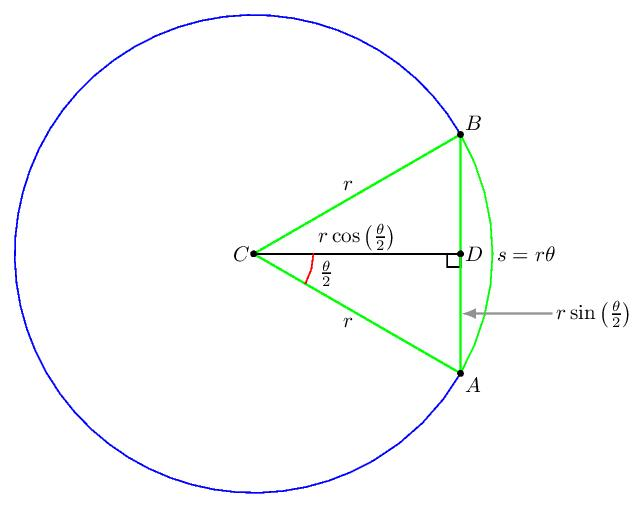

弧长（Arc Length）和弦长（Chord Length）是圆几何中两个非常重要的概念，尤其在图形学、Shader、曲线计算和角度转换中经常使用。

我们从几何关系 → 公式推导 → 公式归纳 → 实际应用四个层次来理解。

# 一、基本几何概念

假设有一个半径为 \(r\) 的圆，圆心为 \(O\)，圆上有两个点 \(A、B\)。

两点对应的圆心角为 \(\theta\)（单位：弧度）。

这里有两个不同的长度：

-   弧长（Arc Length）：沿着圆弧从 A 到 B 的曲线长度。
    
-   弦长（Chord Length）：直接连接 A 和 B 的直线长度。
    

注意：两者虽然对应同一个圆心角，但计算方式不同。

# 二、弧长公式推导

## 1. 从圆的周长出发

我们知道圆的周长：

\[ C=2\pi r \]

一个完整圆对应的圆心角是：

\[ 360^\circ=2\pi \]

如果圆心角为 \(\theta\)（弧度），那么它占整个圆的比例为：

\[ \frac{\theta}{2\pi} \]

因此，弧长就是整个圆周长乘以这个比例：

\[ L=2\pi r\cdot\frac{\theta}{2\pi} \]

约掉 \(2\pi\)，得到：

-   \(L\)：弧长
    
-   \(r\)：圆的半径
    
-   \(\theta\)：圆心角，单位必须是弧度
<!--stackedit_data:
eyJoaXN0b3J5IjpbNjc4MDEwNDExLC00OTgxNjUyNDksMTY1OD
M4MzE1XX0=
-->