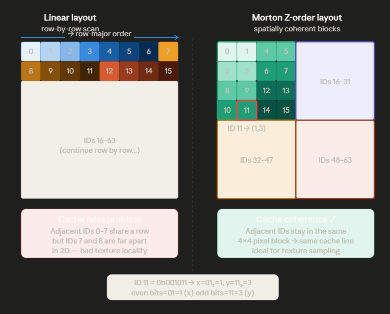

弧长（Arc Length）和弦长（Chord Length）是圆几何中两个非常重要的概念，尤其在图形学、Shader、曲线计算和角度转换中经常使用。

我们从几何关系 → 公式推导 → 公式归纳 → 实际应用四个层次来理解。

# 一、基本几何概念

假设有一个半径为 \(r\) 的圆，圆心为 \(O\)，圆上有两个点 \(A、B\)。

两点对应的圆心角为 \(\theta\)（单位：弧度）。

<!--stackedit_data:
eyJoaXN0b3J5IjpbMTc5MDU0MjkzMiwtNDk4MTY1MjQ5LDE2NT
gzODMxNV19
-->